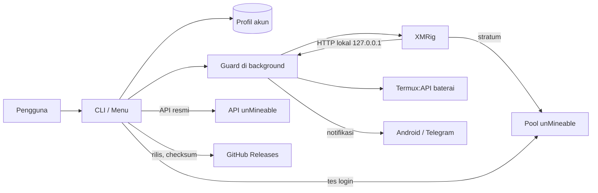
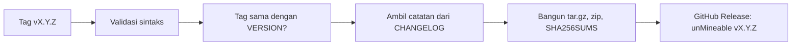

# Arsitektur

Dokumen ini menjelaskan bagaimana unMineable Termux Miner disusun: proses yang berjalan, tanggung jawab tiap modul, lokasi data, dan keputusan desain di baliknya.

## Gambaran umum

Tool ini adalah lapisan pengelola di atas XMRig. Ia tidak menambang sendiri. Tugasnya memastikan syarat terpenuhi (sudah login, XMRig terdeteksi), menjalankan XMRig dengan argumen yang benar untuk pool unMineable, menjaga perangkat tetap aman (suhu dan baterai), dan membantu pengguna memahami apa yang terjadi.



## Tiga proses

| Proses | Umur | Peran |
|---|---|---|
| **CLI / menu** | selama pengguna membuka tool | antarmuka, wizard login, dashboard, tes koneksi, pembaruan |
| **Guard** | berjalan di background sampai dihentikan | memutuskan kapan XMRig boleh jalan, memulai ulang bila berhenti, mencatat riwayat, mengirim notifikasi |
| **XMRig** | dimulai dan dihentikan oleh guard | melakukan mining dan berbicara dengan pool |

Guard dan XMRig dijalankan dengan sesi sendiri (`start_new_session`), sehingga tetap hidup setelah menu ditutup. Status dilacak lewat berkas PID (`guard.pid`, `xmrig.pid`). Karena guard adalah induk XMRig, guard memanggil `waitpid` agar proses yang berhenti tidak tertinggal sebagai zombie.

## Siklus guard

Setiap 20 detik guard melakukan hal berikut:

1. Memuat ulang profil aktif, sehingga perubahan konfigurasi berlaku tanpa restart guard.
2. Memeriksa syarat: profil sudah login (`session_ok`) dan XMRig terdeteksi. Jika tidak terpenuhi, XMRig dihentikan dan alasannya dicatat sekali di `guard.log`.
3. Membaca baterai lewat Termux:API dan memanggil `decide()`:
   - pause bila suhu mencapai `max_temp`, lanjut setelah turun ke `resume_temp` (histeresis supaya tidak naik-turun terus)
   - pause bila mode hanya-charging aktif dan tidak sedang charging
   - pause bila baterai di bawah `min_battery` dan tidak charging
4. Memulai XMRig bila belum jalan. Jika gagal, percobaan berikutnya ditunda dengan jeda bertahap `15 x 2^n` detik (maksimal 300 detik), dan setelah tiga kegagalan guard mengirim notifikasi.
5. Setiap 5 menit membaca log XMRig untuk mendeteksi masalah koneksi dan memberi tahu pengguna satu kali.
6. Setiap 60 detik mengambil ringkasan dari HTTP API lokal XMRig dan menyimpan sampel hashrate ke riwayat.

## Modul

| Modul | Tanggung jawab |
|---|---|
| `constants.py` | versi, URL, daftar endpoint pool, tautan resmi |
| `paths.py` | semua lokasi berkas dan folder |
| `ui.py` | mode layar penuh, kotak, tabel, input, panel berukuran tetap, pagination, kelas `Menu` |
| `system.py` | baterai, suhu, clipboard, buka browser, proses, info perangkat |
| `coins.py` | katalog koin dan validasi format alamat |
| `config.py` | dataclass `Profile`, penyimpanan profil, profil aktif |
| `api.py` | klien HTTP: API resmi unMineable dan HTTP API lokal XMRig |
| `connection.py` | tes login stratum ke pool, analisis log XMRig, pemeriksaan sinkron ke website |
| `installer.py` | pemasangan dependensi dan XMRig, deteksi XMRig |
| `miner.py` | menyusun perintah XMRig, menjalankan, menghentikan, mining foreground |
| `guard.py` | keputusan pause/lanjut dan proses background |
| `history.py` | riwayat hashrate (JSON Lines) |
| `notify.py` | notifikasi Android dan Telegram |
| `stats.py` | dashboard, status, statistik akun |
| `logs.py` | membaca dan mengikuti log |
| `benchmark.py` | benchmark RandomX |
| `doctor.py` | diagnosa lingkungan dan saran |
| `updater.py` | cek rilis, unduh, verifikasi SHA256, terapkan pembaruan |
| `boot.py` | skrip autostart Termux:Boot |
| `web.py` | tautan website dan panduan |
| `profiles.py` | wizard login, verifikasi, logout, manajemen profil |
| `settings.py` | pengaturan performa, proteksi, pool, notifikasi |
| `actions.py` | aksi bersama menu dan CLI, termasuk pemeriksaan syarat mining |
| `menu.py` | susunan menu |
| `cli.py` | argparse dan titik masuk |

Arah ketergantungan dijaga satu arah: modul dasar (`constants`, `paths`, `ui`, `system`, `coins`) tidak mengimpor modul tingkat atas. `actions` dan `menu` berada di lapisan paling atas.

## Syarat mining

Aturan "harus login dan XMRig terdeteksi" ditegakkan di dua tempat supaya tidak ada jalur yang terlewat:

- `actions.preflight()` untuk semua pemanggilan dari pengguna: menu, `start`, mining foreground, autostart saat boot
- `Guard.blocked()` di dalam siklus guard, sehingga perubahan di tengah jalan (logout, XMRig dihapus) langsung menghentikan mining

"Login" berarti `Profile.logged_in` bernilai benar. Nilai itu hanya diatur setelah `connection.scan()` membuktikan pool menerima login, atau pengguna secara sadar memilih lanjut ketika pool tidak membalas.

## Perintah XMRig

`miner.build_command()` menyusun satu blok pool untuk setiap endpoint dalam `Profile.endpoints()`:

```
-o ENDPOINT -a rx -k -u USERNAME -p x
```

Endpoint utama diikuti pool cadangan (port 13333, SSL 443, port 80) sehingga XMRig berpindah sendiri bila satu port diblokir. Argumen global menyusul: `-t`, `--donate-level`, `--cpu-priority`, `--retries=3`, `--retry-pause=5`, `--print-time=60`, `--no-color`, serta `--http-host=127.0.0.1 --http-port=18080` bila build XMRig mendukung HTTP API.

Format username:

| Mode | Username |
|---|---|
| alias | `ALIAS.WORKER` |
| alamat | `COIN:ALAMAT[:MEMO].WORKER[#REFERRAL]` |

## Verifikasi koneksi

`connection.login_test()` membuka koneksi TCP (atau TLS) ke pool, mengirim pesan `login` JSON-RPC dengan username pengguna, dan membaca balasannya. Hasilnya dipakai untuk wizard login (membuktikan akun diterima) dan `unmineable sync`. Pemeriksaan TLS sengaja tidak memverifikasi sertifikat, karena hanya menguji keterjangkauan dan penerimaan login, sama seperti perilaku bawaan XMRig.

`connection.log_findings()` membaca ekor log XMRig, menghitung share diterima/ditolak, mengenali pool yang dipakai, dan menerjemahkan pesan error menjadi saran dalam bahasa sederhana.

## Lapisan tampilan

Tujuannya adalah tampilan yang tidak menumpuk ke bawah.

- `enter_screen()` masuk ke alternate screen buffer terminal, `leave_screen()` mengembalikannya saat keluar (didaftarkan lewat `atexit`).
- `Menu.compose()` menghitung tinggi tampilan dan memilih header penuh, header ringkas, atau tanpa header agar semuanya muat di tinggi terminal.
- Handler menu ada dua jenis. **View**: keluarannya ditangkap lalu ditampilkan lewat `paginate()` per halaman. **Live**: berinteraksi dengan pengguna atau men-stream proses, ditandai dengan `ui.live`.
- Proses panjang (pasang paket, build XMRig, benchmark, mining foreground) memakai `run_command_panel()` yang menampilkan hanya baris terbaru dalam kotak berukuran tetap. Log live memakai `follow_panel()`.
- Saat keluaran bukan terminal (pipe), warna dan pembersihan layar dimatikan sehingga keluaran linear dan mudah diproses.

## Lokasi data

| Lokasi | Isi |
|---|---|
| `~/.config/unmineable/profiles/NAMA.json` | profil akun dan pengaturan (izin `600`) |
| `~/.config/unmineable/active_profile` | nama profil aktif |
| `~/.config/unmineable/logs/xmrig.log`, `guard.log` | log, dirotasi ke `.log.1` bila melewati 5 MB |
| `~/.config/unmineable/history.jsonl` | riwayat hashrate, dipangkas ke 2000 baris |
| `~/.config/unmineable/guard.pid`, `xmrig.pid` | PID proses |
| `~/.config/unmineable/update_check.json` | cache pengecekan versi |
| `~/.unmineable/bin/xmrig` | XMRig hasil build dari source |
| `~/.unmineable/src/` | source XMRig untuk build |
| `~/.unmineable/app/` | salinan tool bila dipasang dari release |
| `~/.termux/boot/unmineable-start` | skrip autostart (jika diaktifkan) |
| `$PREFIX/bin/unmineable` | tautan simbolik ke `unmineable.sh` |

Folder konfigurasi mengikuti `XDG_CONFIG_HOME` bila diatur.

## Pembaruan

`updater.update()` bekerja sesuai jenis pemasangan:

- **git clone**: `git fetch --tags`, lalu checkout tag rilis (channel `release`) atau pull branch `main`
- **arsip / release**: unduh `.tar.gz` rilis, cocokkan SHA256 dengan `SHA256SUMS`, ekstrak ke folder sementara dengan pemeriksaan jalur dan penolakan tautan, lalu ganti paket dan berkas akar. Paket baru disiapkan di `unmineable.new` lalu ditukar agar tidak ada keadaan setengah jadi.

Pemberitahuan versi baru di menu memakai cache dan memeriksa paling banyak setiap 12 jam, dengan batas waktu 4 detik.

## Pipeline rilis



Rilis gagal bila tag tidak sama dengan `VERSION` atau catatan versi itu tidak ada di `CHANGELOG.md`.

## Keputusan desain

- **Hanya pustaka standar Python.** Memudahkan pemasangan di Termux dan mengurangi risiko rantai pasok.
- **Guard terpisah dari menu.** Mining harus tetap berjalan saat menu ditutup, dan keputusan suhu tidak boleh bergantung pada pengguna yang sedang melihat layar.
- **Berkas PID, bukan layanan.** Sederhana dan bekerja di Termux tanpa init system.
- **`PYTHONSAFEPATH=1` di launcher.** Mencegah folder `unmineable/` di direktori kerja menimpa paket yang terpasang.
- **Tanpa komentar dan docstring.** Kode harus menjelaskan dirinya lewat nama. Aturan ini dijaga di [CONTRIBUTING.md](../CONTRIBUTING.md).
- **Tanpa telemetri.** Lihat [PRIVACY.md](PRIVACY.md).
- **Syarat mining tidak bisa dilewati.** Ditegakkan di `preflight` dan di guard.
